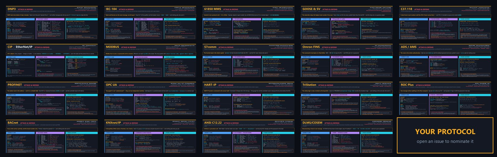

# OT Security One-Pagers

**One protocol. One sheet. Everything you need to attack it, defend it, and not get fooled by it.**

  
  
  
  
  

  

You have a packet capture open, a protocol you half-remember, and no time to read a
four-hundred-page specification. **Each sheet is the one page you need: what the protocol is,
what every command does to the equipment it controls, how an attacker would use it, and the
exact filter that catches them.**

Nineteen industrial protocols, covering the power grid, factory controllers (PLCs), field
instruments, safety systems, building automation and smart meters. Every sheet uses the same
layout, so once you've read one you know where to find things on all the others.

> [!TIP]
> **New — November 2026: sixteen sheets in one drop**, from IEC-104 and IEC 61850 to TriStation,
> HART-IP and smart meters. **[Find yours →](#find-your-sheet)**

## Why people keep them open

- 🎯 **The key point first.** A banner across the top of each sheet sums up, in one sentence,
  the thing that matters most about that protocol, usually where its security falls apart. For
  Modbus: anyone who can reach the device can read and write it, because there are no users or
  passwords.
- 🔴 **Commands colour-coded by what they do to the plant.** Every command in the protocol is
  listed, and coloured by its real-world effect: grey only reads data, blue maps the system,
  orange changes a setting, and red operates equipment or stops a controller.
- 🟢 **Detection you can copy and paste.** Ready-to-use filters and rules for the common tools
  (tcpdump, Zeek, Suricata, Wireshark), plus the single most useful search to run for that
  protocol.
- ⚠️ **Common mistakes called out.** Each sheet has a warning box listing the ways analysts
  usually misread that protocol. One example: a device number in a capture doesn't tell you
  which physical breaker it controls.
- 📚 **Checked against the sources.** Every Wireshark filter was tested against a real Wireshark
  install, and every value is traced to the specification or the vendor's manual, which the
  sheet names.
- ✏️ **Editable and free to use.** The `.pptx` source is included, and the licence is CC BY 4.0,
  commercial use permitted.

## Find your sheet

### 🔌 By what you see on the wire

Look up the port number (or, for traffic without an IP address, the EtherType) from your capture, firewall log or Shodan search.

| You see | It is probably | Sheet |
|---|---|---|
| `502/tcp` | Modbus TCP | [Modbus](./Modbus/) |
| `44818/tcp`, `2222/udp` | EtherNet/IP + CIP | [CIP](./CIP/) |
| `20000/tcp` or `/udp` | DNP3 | [DNP3](./DNP3/) |
| `2404/tcp` | IEC 60870-5-104 | [IEC-104](./IEC104/) |
| `102/tcp` | **two candidates** — Siemens S7comm / S7comm-Plus, or IEC 61850 MMS; the S7comm sheet shows how to tell them apart | [S7comm](./S7comm/) · [61850 MMS](./IEC61850-MMS/) |
| EtherType `0x88B8` / `0x88BA` | IEC 61850 GOOSE / Sampled Values (R-GOOSE / R-SV ride UDP) | [GOOSE & SV](./IEC61850-GOOSE/) |
| `4712/tcp`, `4713/udp` | IEEE C37.118 synchrophasors | [C37.118](./C37.118/) |
| `9600/udp` or `/tcp` | Omron FINS | [FINS](./FINS/) |
| `48898/tcp`, `48899/udp` | Beckhoff ADS / AMS | [ADS / AMS](./ADS/) |
| EtherType `0x88A4` | EtherCAT (a panel on the ADS sheet) | [ADS / AMS](./ADS/) |
| EtherType `0x8892`, `34964/udp` | PROFINET RT / DCP, PNIO-CM | [PROFINET](./PROFINET/) |
| `4840/tcp` | OPC UA (`opc.tcp`) | [OPC UA](./OPCUA/) |
| `135/tcp` + dynamic RPC to an OPC server | OPC Classic / DA over DCOM (a panel on the OPC UA sheet) | [OPC UA](./OPCUA/) |
| `5094/tcp` or `/udp` | HART-IP | [HART-IP](./HART-IP/) |
| `1502/udp` | TriStation (Triconex safety controller) | [TriStation](./TriStation/) |
| `4000/tcp` or `/udp` | Emerson ROC Plus | [ROC Plus](./ROC-Plus/) |
| `47808/udp` (`0xBAC0`) | BACnet/IP | [BACnet](./BACnet/) |
| `1911/tcp`, `4911/tcp` | Niagara Fox (a panel on the BACnet sheet) | [BACnet](./BACnet/) |
| `3671/udp`, multicast `224.0.23.12` | KNXnet/IP | [KNXnet/IP](./KNX/) |
| `1153/tcp` or `/udp` | ANSI C12.22 smart meters | [ANSI C12.22](./C12.22/) |
| `4059/tcp` or `/udp` | DLMS/COSEM smart meters | [DLMS/COSEM](./DLMS/) |

These are the usual ports, not guaranteed ones: gateways, serial converters and some vendors use
others. Panel 1 of each sheet lists the alternatives.

### 🏭 By vendor or kit on site

| If the site runs… | Start with |
|---|---|
| Rockwell / Allen-Bradley (ControlLogix, CompactLogix) | [CIP](./CIP/) |
| Siemens (S7-300/400/1200/1500, TIA Portal, ET 200) | [S7comm](./S7comm/) · [PROFINET](./PROFINET/) |
| Schneider Electric (Modicon, Triconex) | [Modbus](./Modbus/) · [TriStation](./TriStation/) |
| Omron (Sysmac NJ/NX, CJ/CS) | [FINS](./FINS/) |
| Beckhoff (TwinCAT, EtherCAT) | [ADS / AMS](./ADS/) |
| Emerson (ROC800, FloBoss flow computers) | [ROC Plus](./ROC-Plus/) |
| Protection relays and RTUs (SEL, GE, Hitachi Energy, Siemens SIPROTEC) | [DNP3](./DNP3/) · [IEC-104](./IEC104/) · [61850 MMS](./IEC61850-MMS/) · [GOOSE & SV](./IEC61850-GOOSE/) |
| PMUs and phasor data concentrators (openPDC, SEL) | [C37.118](./C37.118/) |
| Smart transmitters, asset-management systems, WirelessHART gateways | [HART-IP](./HART-IP/) |
| Building management (Tridium Niagara, Johnson Controls, Honeywell) | [BACnet](./BACnet/) |
| Lighting, blinds and room control (KNX / ETS) | [KNXnet/IP](./KNX/) |
| Utility AMI head-ends and meters | [ANSI C12.22](./C12.22/) (North America) · [DLMS/COSEM](./DLMS/) (Europe and elsewhere) |
| Historians, MES and SCADA integration layers | [OPC UA](./OPCUA/) |

### 🦠 By incident, malware or advisory

When an advisory names a family, this is the sheet that shows what it did on the wire.

| Named in the advisory | What it used | Sheet |
|---|---|---|
| **Industroyer** (Kyiv, 2016) | IEC-104 module, IEC 61850 MMS module | [IEC-104](./IEC104/) · [61850 MMS](./IEC61850-MMS/) |
| **Industroyer2** (Ukraine, April 2022) | IEC-104 only, with the target substation's point addresses built into the malware | [IEC-104](./IEC104/) |
| **CosmicEnergy** (2023) | IEC-104 | [IEC-104](./IEC104/) |
| **TRITON / TRISIS** (2017) | TriStation, against a Triconex safety controller | [TriStation](./TriStation/) |
| **Stuxnet** (Natanz, 2010) | S7comm via a trojanised STEP 7 library | [S7comm](./S7comm/) |
| **FrostyGoop / BUSTLEBERM** (Lviv, January 2024) | Modbus TCP against heating controllers | [Modbus](./Modbus/) |
| **PIPEDREAM / INCONTROLLER** (2022) | A module for Omron PLCs over FINS, an OPC UA module, and tooling for CODESYS-based controllers (which include Beckhoff's) | [FINS](./FINS/) · [OPC UA](./OPCUA/) · [ADS / AMS](./ADS/) |
| **2021 German building-automation lockout** (CVE-2023-4346) | KNX device keys set by an intruder | [KNXnet/IP](./KNX/) |

### 🧭 By the job in front of you

- **"I've been handed a PCAP."** Match ports and EtherTypes with the [wire table](#-by-what-you-see-on-the-wire),
  then go straight to panel 7 on that sheet. It gives the capture filter, the tool that can
  read the protocol, and a short list of questions to work through in order.
- **"I'm hunting in a substation."** [DNP3](./DNP3/) or [IEC-104](./IEC104/) for the SCADA link,
  [61850 MMS](./IEC61850-MMS/) for the station bus, [GOOSE & SV](./IEC61850-GOOSE/) for the process
  bus, [C37.118](./C37.118/) for wide-area monitoring.
- **"Is this command normal?"** Panel 8 on each sheet describes what everyday traffic looks
  like and what should make you look twice, written for someone new to the protocol.
- **"I need detection content."** Panel 7 has ready-to-paste tcpdump, Zeek, Suricata and Wireshark
  syntax. It also says when Zeek or Wireshark cannot read the protocol at all. That matters
  because a tool that can't read the protocol shows no alerts, which looks the same as a network
  with nothing going on.
- **"I'm writing the assessment report."** Panel 9 lists hardening steps, and panel 10 gives the
  ATT&CK for ICS technique IDs plus any real-world attack that used the protocol.
- **"I'm teaching an IT analyst OT."** Start with [Modbus](./Modbus/) (simplest), then [DNP3](./DNP3/)
  and [IEC-104](./IEC104/) as a matched pair. Practise against real captures in
  [ICS-PCAP-Challenges](https://github.com/SackOfHacks/ICS-PCAP-Challenges), which covers every
  protocol here.

## All nineteen sheets

Every sheet ships as an editable **PPTX**, a vector **PDF** for print and a 300 dpi **PNG** for
screens. **Preview** opens a quick 800 px look before you download.

| Sheet | Domain | The key point in one sentence | Get it |
|---|---|---|---|
| [**DNP3**](./DNP3/) | Grid | Breaker commands use a two-step "arm, then fire" exchange, and neither step checks who sent it | [PDF](./DNP3/DNP3_Attack_Defend_Poster.pdf) · [PNG](./DNP3/DNP3_Attack_Defend_Poster.png) · [PPTX](./DNP3/DNP3_Attack_Defend_Poster.pptx) · [preview](./assets/DNP3_Attack_Defend_Poster_thumb.jpg) |
| [**IEC-104**](./IEC104/) | Grid | The "arm" and "fire" versions of a breaker command differ by one bit, and the device never checks who sent it | [PDF](./IEC104/IEC104_Attack_Defend_Poster.pdf) · [PNG](./IEC104/IEC104_Attack_Defend_Poster.png) · [PPTX](./IEC104/IEC104_Attack_Defend_Poster.pptx) · [preview](./assets/IEC104_Attack_Defend_Poster_thumb.jpg) |
| [**61850 MMS**](./IEC61850-MMS/) | Grid | Tripping a breaker or changing a protection setting is just a "write" to a named data item | [PDF](./IEC61850-MMS/IEC61850_MMS_Attack_Defend_Poster.pdf) · [PNG](./IEC61850-MMS/IEC61850_MMS_Attack_Defend_Poster.png) · [PPTX](./IEC61850-MMS/IEC61850_MMS_Attack_Defend_Poster.pptx) · [preview](./assets/IEC61850_MMS_Attack_Defend_Poster_thumb.jpg) |
| [**GOOSE & SV**](./IEC61850-GOOSE/) | Grid | Relays act on whichever message carries the highest sequence number, so a forged message with a higher number wins | [PDF](./IEC61850-GOOSE/IEC61850_GOOSE_SV_Attack_Defend_Poster.pdf) · [PNG](./IEC61850-GOOSE/IEC61850_GOOSE_SV_Attack_Defend_Poster.png) · [PPTX](./IEC61850-GOOSE/IEC61850_GOOSE_SV_Attack_Defend_Poster.pptx) · [preview](./assets/IEC61850_GOOSE_SV_Attack_Defend_Poster_thumb.jpg) |
| [**C37.118**](./C37.118/) | Grid | The measurement data is unreadable without a separate configuration message, and the device sends that message to anyone who asks | [PDF](./C37.118/C37118_Synchrophasor_Attack_Defend_Poster.pdf) · [PNG](./C37.118/C37118_Synchrophasor_Attack_Defend_Poster.png) · [PPTX](./C37.118/C37118_Synchrophasor_Attack_Defend_Poster.pptx) · [preview](./assets/C37118_Synchrophasor_Attack_Defend_Poster_thumb.jpg) |
| [**CIP**](./CIP/) | PLC | Every request names an action and the object it acts on, so the object path tells you what is being done | [PDF](./CIP/CIP_EtherNetIP_Attack_Defend_Poster.pdf) · [PNG](./CIP/CIP_EtherNetIP_Attack_Defend_Poster.png) · [PPTX](./CIP/CIP_EtherNetIP_Attack_Defend_Poster.pptx) · [preview](./assets/CIP_EtherNetIP_Attack_Defend_Poster_thumb.jpg) |
| [**Modbus**](./Modbus/) | PLC | There are no users, passwords or sessions: anyone who can reach the device can read and write its memory | [PDF](./Modbus/Modbus_Attack_Defend_Poster.pdf) · [PNG](./Modbus/Modbus_Attack_Defend_Poster.png) · [PPTX](./Modbus/Modbus_Attack_Defend_Poster.pptx) · [preview](./assets/Modbus_Attack_Defend_Poster_thumb.jpg) |
| [**S7comm**](./S7comm/) | PLC | One byte selects the operation, one value of it (`0x29`) stops the PLC, and nothing checks who sent it | [PDF](./S7comm/S7comm_Attack_Defend_Poster.pdf) · [PNG](./S7comm/S7comm_Attack_Defend_Poster.png) · [PPTX](./S7comm/S7comm_Attack_Defend_Poster.pptx) · [preview](./assets/S7comm_Attack_Defend_Poster_thumb.jpg) |
| [**FINS**](./FINS/) | PLC | The command is two bytes at a fixed position; `04 02` stops the PLC, and no password is asked | [PDF](./FINS/Omron_FINS_Attack_Defend_Poster.pdf) · [PNG](./FINS/Omron_FINS_Attack_Defend_Poster.png) · [PPTX](./FINS/Omron_FINS_Attack_Defend_Poster.pptx) · [preview](./assets/Omron_FINS_Attack_Defend_Poster_thumb.jpg) |
| [**ADS / AMS**](./ADS/) | PLC | The only access control is a "route" entry on the controller, and it can be added remotely with the default password | [PDF](./ADS/Beckhoff_ADS_Attack_Defend_Poster.pdf) · [PNG](./ADS/Beckhoff_ADS_Attack_Defend_Poster.png) · [PPTX](./ADS/Beckhoff_ADS_Attack_Defend_Poster.pptx) · [preview](./assets/Beckhoff_ADS_Attack_Defend_Poster_thumb.jpg) |
| [**PROFINET**](./PROFINET/) | PLC | Devices are identified by a name that anyone on the network can change, and renaming one knocks it offline | [PDF](./PROFINET/PROFINET_Attack_Defend_Poster.pdf) · [PNG](./PROFINET/PROFINET_Attack_Defend_Poster.png) · [PPTX](./PROFINET/PROFINET_Attack_Defend_Poster.pptx) · [preview](./assets/PROFINET_Attack_Defend_Poster_thumb.jpg) |
| [**OPC UA**](./OPCUA/) | PLC / integration | Encryption and login are separate settings, so a connection can be encrypted yet anonymous, and the server tells you which if you ask | [PDF](./OPCUA/OPC_UA_Attack_Defend_Poster.pdf) · [PNG](./OPCUA/OPC_UA_Attack_Defend_Poster.png) · [PPTX](./OPCUA/OPC_UA_Attack_Defend_Poster.pptx) · [preview](./assets/OPC_UA_Attack_Defend_Poster_thumb.jpg) |
| [**HART-IP**](./HART-IP/) | Field | Commands go straight to the field instrument, and one of them (Command 40) freezes its reading at a fake value the control system believes | [PDF](./HART-IP/HART-IP_Attack_Defend_Poster.pdf) · [PNG](./HART-IP/HART-IP_Attack_Defend_Poster.png) · [PPTX](./HART-IP/HART-IP_Attack_Defend_Poster.pptx) · [preview](./assets/HART-IP_Attack_Defend_Poster_thumb.jpg) |
| [**TriStation**](./TriStation/) | Safety | The physical key switch on the safety controller is its only protection, because the network protocol checks nothing | [PDF](./TriStation/TriStation_Attack_Defend_Poster.pdf) · [PNG](./TriStation/TriStation_Attack_Defend_Poster.png) · [PPTX](./TriStation/TriStation_Attack_Defend_Poster.pptx) · [preview](./assets/TriStation_Attack_Defend_Poster_thumb.jpg) |
| [**ROC Plus**](./ROC-Plus/) | Oil & gas | One command (opcode 181) can change any setting, including the flow values that billing is based on, and the login password travels unencrypted | [PDF](./ROC-Plus/ROC_Plus_Attack_Defend_Poster.pdf) · [PNG](./ROC-Plus/ROC_Plus_Attack_Defend_Poster.png) · [PPTX](./ROC-Plus/ROC_Plus_Attack_Defend_Poster.pptx) · [preview](./assets/ROC_Plus_Attack_Defend_Poster_thumb.jpg) |
| [**BACnet**](./BACnet/) | Building | Every write carries a priority number, a lower number overrides the operator's setting, and the sender is never checked | [PDF](./BACnet/BACnet_Attack_Defend_Poster.pdf) · [PNG](./BACnet/BACnet_Attack_Defend_Poster.png) · [PPTX](./BACnet/BACnet_Attack_Defend_Poster.pptx) · [preview](./assets/BACnet_Attack_Defend_Poster_thumb.jpg) |
| [**KNXnet/IP**](./KNX/) | Building | A command addresses a function ("floor 1 lights") rather than a device, carries no sender, and every device listening obeys it | [PDF](./KNX/KNXnetIP_Attack_Defend_Poster.pdf) · [PNG](./KNX/KNXnetIP_Attack_Defend_Poster.png) · [PPTX](./KNX/KNXnetIP_Attack_Defend_Poster.pptx) · [preview](./assets/KNXnetIP_Attack_Defend_Poster_thumb.jpg) |
| [**ANSI C12.22**](./C12.22/) | Metering | Writing to one particular table makes the meter run a built-in routine, and one of those routines cuts the customer's power | [PDF](./C12.22/ANSI_C1222_Attack_Defend_Poster.pdf) · [PNG](./C12.22/ANSI_C1222_Attack_Defend_Poster.png) · [PPTX](./C12.22/ANSI_C1222_Attack_Defend_Poster.pptx) · [preview](./assets/ANSI_C1222_Attack_Defend_Poster_thumb.jpg) |
| [**DLMS/COSEM**](./DLMS/) | Metering | Cutting power to a household takes one command to the meter's disconnect function | [PDF](./DLMS/DLMS_COSEM_Attack_Defend_Poster.pdf) · [PNG](./DLMS/DLMS_COSEM_Attack_Defend_Poster.png) · [PPTX](./DLMS/DLMS_COSEM_Attack_Defend_Poster.pptx) · [preview](./assets/DLMS_COSEM_Attack_Defend_Poster_thumb.jpg) |

**Read them in pairs.** Four pairs of sheets cover similar protocols and point out where they
match and where they differ, so once you know one the other is quick to learn:
**DNP3 ↔ IEC-104** (grid control in North America and in Europe), **61850 MMS ↔ GOOSE & SV** (the two halves of one standard), **BACnet ↔ KNXnet/IP** (the two
building buses) and **ANSI C12.22 ↔ DLMS/COSEM** (North American and European metering).

## What's on every sheet

Ten panels, always in the same place, always in the same order:

| | Panel | | Panel |
|---|---|---|---|
| 🎯 | **The key point** — what matters most, in one sentence | 6 | **Attacker playbook** — how an attack unfolds, step by step |
| 1 | **Where it lives** — versions, ports, and where it sits in a plant network | 7 | **Defender playbook** — how to capture it, detect misuse and decide what matters |
| 2 | **The data model** — how the protocol names the things it controls | 8 | **Normal vs suspicious** — what everyday traffic looks like, and what doesn't fit |
| 3 | **The message layout** — a message taken apart byte by byte | 9 | **Hardening** — concrete controls and the standards behind them |
| 4 | **Commands** — every one, coloured by its real-world effect | 10 | **ATT&CK for ICS** — the standard attack-technique IDs, and real attacks that used the protocol |
| 5 | **What attackers go after** — the protocol's most dangerous features | ⚠️ | **Common mistakes** — how analysts usually misread this protocol |

Laid out for **18 × 24 in at 300 dpi**: print one for the SOC wall or the control-room door. It
also reads fine on a monitor at 100% zoom, one panel at a time.

## Accuracy

Every value is checked against the original sources: the published specification, the vendor's
manuals, and the source code of the Wireshark decoder for that protocol. Every Wireshark filter on
a sheet was tested against Wireshark 4.6.10. For Zeek, each sheet says whether support is built
in, comes from a free CISA/INL add-on (ICSNPP), or doesn't exist. Malware and incidents are named
only where they really used the protocol. Where no real-world attack is known, the sheet says so
and points to the key published research instead.

<b>Sources, sheet by sheet</b>

- **CIP** — the Wireshark ENIP/CIP dissectors, the ODVA developers guide, Rockwell's Logix 5000 Data Access manual.
- **Modbus** — the Wireshark Modbus dissector (`packet-mbtcp.c`), the Modbus Organization Application Protocol Specification v1.1b3.
- **DNP3** — IEEE 1815-2012, the DNP Users Group object library, the Wireshark DNP3 dissector, CISA/INL ICSNPP-DNP3.
- **IEC-104** — IEC 60870-5-104 and -101, IEC 62351-3/-5, the Wireshark `iec60870_104` / `iec60870_asdu` dissectors, the community ICSNPP-IEC104 parser.
- **61850 MMS / GOOSE & SV** — IEC 61850-7-2/-8-1/-9-2, IEC 61850-90-5, IEC 62351-6, ISO 9506, the Wireshark `mms`, `goose`, `sv` and `rgoose` dissectors.
- **C37.118** — IEEE C37.118.1/.2-2011, the Wireshark `synphasor` dissector, CISA ICSNPP-Synchrophasor.
- **S7comm** — the Wireshark `s7comm` / COTP / TPKT dissectors, ICSNPP-S7comm (including its S7comm-Plus tables, since Wireshark has no mainline S7comm-Plus dissector), Biham et al. "Rogue7" (Black Hat USA 2019).
- **FINS** — the Wireshark `omron` dissector, Omron W227, ICSNPP-Omron-FINS.
- **ADS / AMS** — the Wireshark `ams` and `ecat` dissectors, Beckhoff InfoSys, the ETG EtherCAT specification.
- **PROFINET** — the Wireshark `pn_dcp` / `pn_rt` / `pn_io` dissectors, the PI specification family, ICSNPP-PROFINET.
- **OPC UA** — OPC UA Parts 4 and 6, the Wireshark `opcua` dissector (service NodeIds checked against its value table).
- **HART-IP** — HCF_SPEC-085, the Wireshark `hart_ip` dissector, ICSNPP-HART-IP.
- **TriStation** — the Nozomi Networks TriStation dissector. There is no mainline Wireshark or Zeek parser, and the sheet says so.
- **ROC Plus** — the Emerson ROC Plus Protocol Specifications Manual via the CISA/INL ICSNPP-ROCplus parser. There is no mainline Wireshark dissector.
- **BACnet / KNXnet/IP** — ANSI/ASHRAE 135, the KNX Standard v2.1, the Wireshark `bvlc` / `bacnet` / `bacapp` and `knxip` / `cemi` dissectors, ICSNPP-BACnet (KNX has no Zeek parser).
- **ANSI C12.22 / DLMS/COSEM** — ANSI C12.22/C12.19/C12.18/C12.21, IEEE 1703/1377, IEC 62056 (Green and Blue Books), the Wireshark `c1222`, `dlms` and `cosem` dissectors, ICSNPP-C1222.

Spotted something wrong? **Open an issue with the source to check against, or send a PR.**
Corrections to values, command descriptions and detection rules are especially welcome.

## Not finding your protocol?

The set was checked against all 28 OT protocols in
[ICS-PCAP-Challenges](https://github.com/SackOfHacks/ICS-PCAP-Challenges). Some are covered
inside a closely related sheet instead of getting their own, and a few were left out on purpose.

<b>Where the other protocols went, and why</b>

| Protocol | Where it is | Why |
|---|---|---|
| S7comm-Plus | panel on **[S7comm](./S7comm/)** | the newer version of the same Siemens protocol, on the same port and found the same way |
| IEC 61850 Sampled Values, R-GOOSE / R-SV | on **[GOOSE & SV](./IEC61850-GOOSE/)** | the same broadcast-style messaging, attacked the same way; R-GOOSE is simply GOOSE that can cross a router |
| OPC DA (OPC Classic over DCOM) | panel on **[OPC UA](./OPCUA/)** | on the network it is ordinary Windows remote-procedure traffic, so it is a Windows problem more than an industrial one; OPC UA replaced it |
| EtherCAT | panel on **[ADS / AMS](./ADS/)** | it runs inside a single machine where nobody captures traffic; you reach it through ADS |
| Niagara Fox | panel on **[BACnet](./BACnet/)** | no public specification exists, so only how it appears on the internet can be checked |
| Ethernet POWERLINK | no sheet | it runs inside a single machine, has no monitoring tool support and no known attacks |
| LonTalk (ISO/IEC 14908) | no sheet | an older building protocol, now usually reached through a Niagara or BACnet system that has a sheet |
| LS XGT FEnet | no sheet | used by one vendor, mostly in one region; open an issue if you run it |

**Next up**, in no fixed order: MELSEC / SLMP · CODESYS runtime · ICCP / TASE.2 · PCCC / DF1 ·
GE-SRTP · BSAP. [Open an issue](https://github.com/SackOfHacks/OT_Security_OnePagers/issues) to
push one up the list or nominate another. Requests decide what gets drawn next, and if a sheet
saved you an hour, a ⭐ is the other signal that reaches me.

## Use them, fork them, build on them

[**CC BY 4.0**](./LICENSE). Print them, hand them out, put them in a deck, take them into a
client engagement or a paid training room. The only condition is credit:

> OT Security One-Pagers — https://github.com/SackOfHacks/OT_Security_OnePagers — CC BY 4.0

If you extend or restyle a sheet, say what you changed. To add a sheet, drop
`<PROTOCOL>/<Name>_Attack_Defend_Poster.{pdf,png,pptx}` into a new directory, render an 800 px
thumbnail to `assets/<Name>_Attack_Defend_Poster_thumb.jpg`, add a row to the index and the
lookup tables, and bump the badge. Keep the ten-panel order: the layout only works if every
sheet keeps it.

> [!WARNING]
> **Lab and reference material.** Exercise the offensive content only against equipment you are
> authorised to test. OT protocol writes move physical process: a stop command is an outage, a
> coil write is an output changing state, a DNP3 Operate is a breaker, and anything written to
> a safety controller sits between a process upset and an injury.

<b>Release log</b>

| Date | What landed |
|---|---|
| 2026-11-20 | **Sixteen sheets**: IEC-104, S7comm & S7comm-Plus, Omron FINS, IEC 61850 MMS, IEC 61850 GOOSE & SV, OPC UA, Beckhoff ADS / AMS, BACnet, KNXnet/IP, PROFINET, HART-IP, TriStation, ROC Plus, ANSI C12.22, DLMS/COSEM and IEEE C37.118, all v1.0. README rebuilt around finding the right sheet |
| 2026-11-20 | CIP and DNP3 re-rendered: one callout on each ran past its border. Wording tightened, no technical value changed |
| 2026-09-21 | **DNP3 v1.0**: object library, three-sublayer frame anatomy, the CROB and the IIN |
| 2026-09-21 | Repo checks and a strict-allowlist `.gitignore` |
| 2026-09-12 | CC BY 4.0 licence |
| 2026-09-03 | **Modbus v1.0**: four data banks, function codes, FC 8 diagnostics, the 4xxxx addressing trap |
| 2026-08-15 | **CIP / EtherNet/IP v1.0**: service codes, object model, connection chain |

